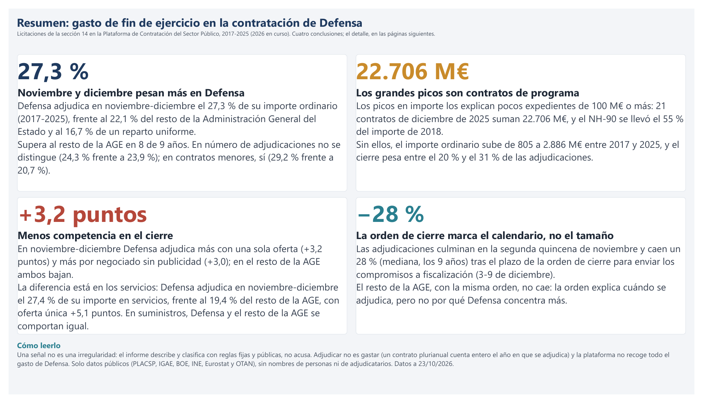
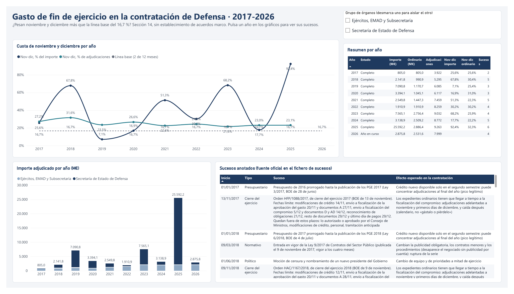
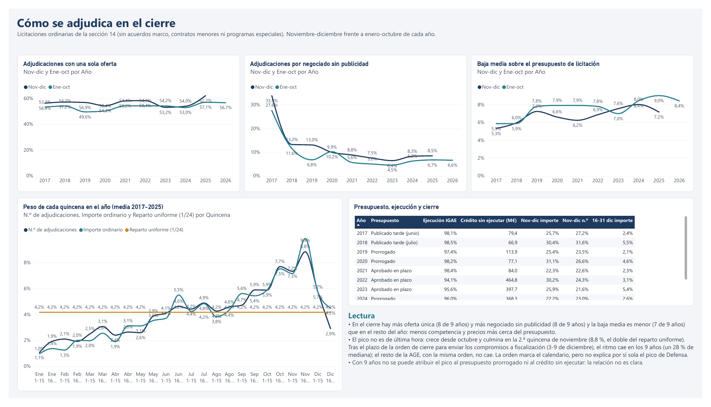
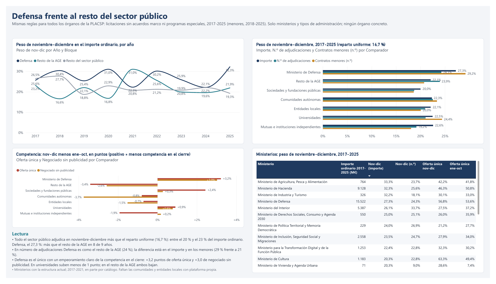
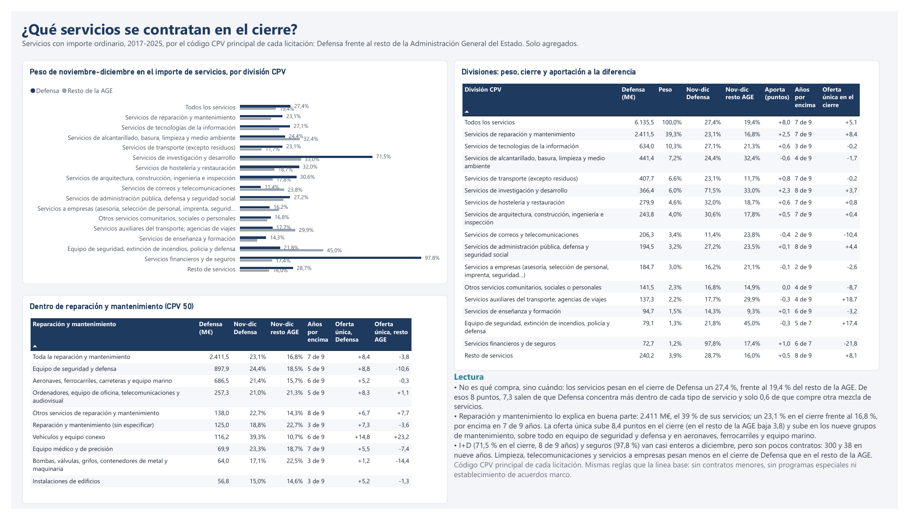
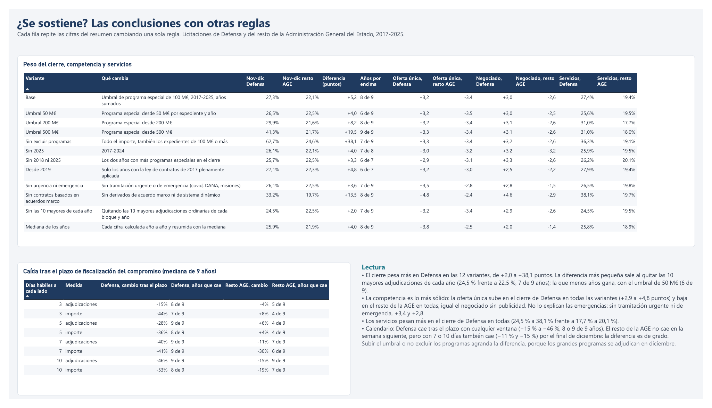

# Gasto de fin de ejercicio en la contratación del Ministerio de Defensa (2017–2026)

¿Se concentra la contratación del Ministerio de Defensa en noviembre y diciembre más de lo que explica el calendario normal? Este proyecto lo mide con datos públicos, como un problema de incentivos ("gástalo o piérdelo") y no de personas, y separa los picos explicables de los que merecen una segunda mirada.

**Herramientas:** Power BI (modelo semántico, DAX, Power Query, tema propio `DefensaSobrio`), Python y JavaScript para la extracción de datos.

## Capturas



| | |
|---|---|
|  |  |
| Serie 2017-2026 y sucesos | Cómo se adjudica en el cierre |
|  |  |
| Defensa frente al resto del sector público | Qué servicios se contratan en el cierre |
|  | El informe completo, con sus 14 páginas, está en [`informe_gasto_fin_ejercicio_defensa.pdf`](informe_gasto_fin_ejercicio_defensa.pdf). |
| ¿Se sostiene? Las conclusiones con otras reglas | |

## Principios

- **Solo datos públicos.** Nada interno, nada de destinos propios ni de casos conocidos por el servicio (deber de reserva).
- **Incentivos, no personas.** El análisis llega hasta el órgano de contratación y el tipo de contrato; nunca nombra a personas ni a adjudicatarios.
- **Sin reidentificación.** Los adjudicatarios solo se usan como huellas anónimas para calcular, y lo que se publica es agregado. Las huellas no se publican: junto con el importe y los expedientes públicos permitirían reconocer a una empresa. Los grupos de menos de 5 adjudicatarios se suprimen. `registros/` y `privado/` son de uso interno.
- **Una señal no es una irregularidad.** Cada pico se clasifica como explicable, a vigilar o sin explicar; el proyecto no emite juicios sobre legalidad.

## Estado — 24/10/2026

| Fase | Estado |
| --- | --- |
| 1. Preparación y protocolo de reserva | Hecha |
| 2. Prueba de cobertura con 2023 | Hecha: la PLACSP sirve como fuente principal |
| 3. Datos 2017–2026 | Hecha: 10 años extraídos y unidos (el de 2026, a 23/10/2026) |
| 4. Análisis e índice de cierre | Hecha: picos clasificados (111), adjudicatarios (rotación, concentración, especialización), competencia y calendario del cierre, presupuesto, contexto económico (IPC, PIB, OTAN), sucesos (43, con las 9 órdenes de cierre) e IGAE 2017–2025 |
| 5. Informe en Power BI | Hecha: 14 páginas sobre la serie 2017–2026 (`powerbi/`), con resumen inicial y tema propio |
| 6. Publicación | Hecha: repositorio público en GitHub (27/10/2026) con resumen, capturas, PDF del informe, licencia y `.gitignore` |
| 7. Prueba con el cierre de 2026 | Predicción fijada el 29/10/2026 ([`prediccion_cierre_2026.md`](prediccion_cierre_2026.md)); se contrasta en enero de 2027 (procedimiento abajo) |
| Contratos menores | Hecha: 2018–2026 integrados (sindicación 1143), aparte del importe analizado |
| Línea base con todo el sector público | Hecha: 1,14 millones de licitaciones y 3,57 millones de menores de todos los órganos de la plataforma, 2017–2026 |
| Servicios por código CPV | Hecha: qué servicios explican la diferencia con el resto de la AGE (paso 10) |
| Robustez | Hecha: las conclusiones con 12 variantes de las reglas y 4 ventanas del calendario (paso 11) |
| Órdenes de cierre del ejercicio | Hecha: las 9 órdenes de Hacienda de 2017–2025 (BOE) con sus fechas límite, contrastadas día a día con Defensa y el resto de la AGE |

## Resultados hasta ahora

Importe analizado: sección 14, con IVA, sin el establecimiento de acuerdos marco. Cobertura: frente a las obligaciones reconocidas de los capítulos 2 y 6 según la IGAE.

| Año | Importe analizado | Obligaciones IGAE | Cobertura | Nov-dic, % importe | Nov-dic, % adjudicaciones | Estado |
| --- | --- | --- | --- | --- | --- | --- |
| 2017 | 805,0 M€ | 4.076,8 M€ | 19,7 % | 25,6 % | 27,2 % | Completo |
| 2018 | 2.141,8 M€ | 4.469,6 M€ | 47,9 % | 67,8 % | 31,6 % | Completo |
| 2019 | 7.090,7 M€ | 4.327,2 M€ | 163,9 % | 7,1 % | 23,5 % | Completo |
| 2020 | 3.394,1 M€ | 4.154,8 M€ | 81,7 % | 16,9 % | 26,6 % | Completo |
| 2021 | 2.549,8 M€ | 5.162,6 M€ | 49,4 % | 51,3 % | 22,6 % | Completo |
| 2022 | 1.910,9 M€ | 7.391,6 M€ | 25,9 % | 30,2 % | 24,3 % | Completo |
| 2023 | 7.565,1 M€ | 8.574,5 M€ | 88,2 % | 68,2 % | 21,6 % | Completo |
| 2024 | 3.138,9 M€ | 8.715,5 M€ | 36,0 % | 17,7 % | 23,0 % | Completo |
| 2025 | 25.592,2 M€ | 11.134,9 M€ | 229,8 % | 92,4 % | 23,1 % | Completo (22.706 M€ en 21 contratos de diciembre) |
| 2026 | 2.875,8 M€ | — | — | — | — | En curso, a 23/10/2026 |

Los programas especiales (expedientes de 100 M€ o más en un año, columna `es_programa_especial`) explican los picos: sin ellos el importe es de 805, 991, 1.171, 1.045, 1.447, 1.911, 2.756, 2.509 y 2.886 M€ en 2017–2025. La publicación puede llegar años tarde (el VAC de 2023 se publicó en 2026) y las anulaciones posteriores quitan importe, así que los años recientes pueden cambiar.

Línea base: 16,7 % (2 de 12 meses).

**Lectura:**

- **2018:** el pico de cierre lo explica un solo contrato. La fabricación de 23 helicópteros NH-90 se adjudicó en diciembre por 1.150,9 M€, el 55 % del año, tras la autorización del Consejo de Ministros del 16 de noviembre de 2018. Sin él, noviembre y diciembre rondan el 30 %.
- **2017:** es anterior a la ley de contratos de 2018 y no tiene contratos menores. Lo publicado en la plataforma solo cubre el 19,7 % del gasto reconocido.
- **2023:** el pico en importe es de unos pocos contratos muy grandes de la Secretaría de Estado de Defensa. Sin ella, noviembre y diciembre concentran el 21,9 % del importe y de las adjudicaciones.
- **2025:** 21 contratos de 100 M€ o más (22.706 M€) se adjudican entre el 17 y el 28 de diciembre, tras el Plan Industrial y Tecnológico de abril. Sin ellos, el cierre de la Secretaría de Estado de Defensa sigue en el 55 % del importe ordinario: queda «a vigilar».
- **En número de adjudicaciones,** el cierre pesa entre el 20 % y el 31 %: algo por encima de la línea base, pero muy lejos de los picos en importe.
- **Picos clasificados** (`picos_cierre.csv`): de 13 picos por rama, 3 explicables, 9 a vigilar y 1 sin explicar (Estado Mayor de la Defensa en 2019, 57 % en nov-dic); de 98 por órgano de contratación, 20 explicables, 53 a vigilar y 25 sin explicar.
- **Concentración en el cierre:** el importe ordinario de noviembre-diciembre está mucho más concentrado en pocos adjudicatarios que el de enero-octubre todos los años desde 2019 (HHI de 245 a 927 frente a 132-175; los 10 mayores se llevan el 38-57 % frente al 29-34 %). Los adjudicatarios habituales (ganaron en alguno de los dos años anteriores) pesaron más en el cierre en 2019-2020 y algo menos desde 2021.
- **Contratos menores** (2018–2025): entre 87 y 197 M€ al año y de 9.000 a 13.600 contratos. En número, noviembre y diciembre pesan más que en las licitaciones todos los años (24–35 % frente a 22–32 %). 401 superan los 40.000 € sin IVA; los mayores son suscripciones a bases de datos y servicios hospitalarios, con reglas propias.
- **Cómo se adjudica en el cierre:** en noviembre-diciembre hay más adjudicaciones con oferta única (8 de 9 años) y por negociado sin publicidad (8 de 9) y la baja media es menor (7 de 9). El pico no es de última hora: las adjudicaciones crecen todo el año y culminan en la segunda quincena de noviembre (8,8 % del año, el doble del reparto uniforme); la segunda de diciembre baja al 2,9 %.
- **Órdenes de cierre del ejercicio** (`ordenes_cierre.csv`, paso 8): cada año el Ministerio de Hacienda publica en el BOE, entre el 9 y el 19 de noviembre, una orden con los plazos de cierre para toda la AGE. Los plazos apenas cambian: envío a fiscalización de la aprobación del gasto del 17 al 25 de noviembre, del compromiso del 3 al 9 de diciembre y documentos D y AD del 12 al 16 de diciembre. En Defensa el ritmo de adjudicaciones sube desde octubre hasta el plazo del compromiso (1,3 veces el de octubre por día hábil) y cae justo después: en los 5 días hábiles siguientes, un 28 % menos que en los 5 anteriores (mediana; cae los 9 años) y, tras los documentos D, a menos de la mitad del ritmo de octubre. **Conclusión: la orden explica el calendario del pico (por qué culmina a finales de noviembre y se hunde en diciembre), pero no su tamaño.** El resto de la AGE, con la misma orden, no cae tras el plazo (mediana +6 %, cae solo 4 de 9 años) y sigue adjudicando a 0,9 veces el ritmo de octubre tras los documentos D. Y como los plazos son casi fijos, una fecha fija (7 de diciembre) da el mismo corte en Defensa: no se puede separar el efecto de la orden del de un calendario interno propio. La orden de 2025 deja fuera de plazo lo aprobado por el Consejo de Ministros y la reserva de munición y el Plan Nacional de Ciberseguridad del Plan Industrial: encaja con los 21 contratos de programa adjudicados del 17 al 28 de diciembre de 2025, después del plazo de los documentos D (12 de diciembre).
- **Defensa frente al resto** (línea base, mismas reglas para todo el sector público de la plataforma): todos adjudican en noviembre-diciembre algo más que el reparto uniforme (entre el 20 % y el 23 % del importe ordinario en 2017-2025). Defensa llega al 27,3 % y supera al resto de la Administración General del Estado (22,1 %) en 8 de 9 años. En número de adjudicaciones no se distingue (24,3 % frente a 23,9 %); en contratos menores sí (29,2 % frente a 20,7 %). Y es el único con un empeoramiento claro de la competencia en el cierre: oferta única +3,2 puntos y negociado sin publicidad +3,0; en universidades suben menos de 1 punto y en el resto de la AGE ambos bajan (−3,4 y −2,6). La serie de Defensa de la línea base cuadra al euro con la del proyecto.
- **Por tipo de contrato:** en suministros Defensa y el resto de la AGE concentran lo mismo en el cierre (28,8 % y 29,1 %, frente al 21,6 % del resto del sector público): es un rasgo de la Administración del Estado. La diferencia está en los servicios: Defensa adjudica en noviembre-diciembre el 27,4 % frente al 19,4 % (más en 7 de 9 años), con oferta única +5,1 puntos y negociado sin publicidad +4,7 en el cierre, cuando en el resto de la AGE bajan. De los 5,2 puntos que separan a Defensa del resto de la AGE, 2,1 se deben a lo que compra (la mitad de su importe son suministros, frente al 30 %) y 3,1 a cómo adjudica los servicios. En contratos menores Defensa concentra más en los tres tipos.
- **Qué servicios** (`servicios_cpv_division.csv` y `servicios_cpv_mantenimiento.csv`, paso 10, por el código CPV principal de cada licitación): no es qué compra, sino cuándo. De los 8 puntos que separan el cierre de los servicios de Defensa (27,4 %) del resto de la AGE (19,4 %), 7,3 salen de que Defensa concentra más dentro de cada división CPV y solo 0,6 de que compre otra mezcla de servicios. La mayor parte la aporta **reparación y mantenimiento** (2.411 M€, el 39 % de sus servicios): un 23,1 % en el cierre frente al 16,8 %, por encima en 7 de 9 años, con la oferta única subiendo 8,4 puntos en el cierre (en el resto de la AGE baja 3,8). Sube en los nueve grupos de mantenimiento, sobre todo en equipo de seguridad y defensa (898 M€, 24,4 % frente a 18,5 %) y en aeronaves, ferrocarriles y equipo marino (686 M€, 21,4 % frente a 15,7 %). I+D (71,5 % en el cierre, 8 de 9 años) y seguros (97,8 %, renovaciones anuales) van casi enteros a diciembre, pero son pocos contratos (300 y 38 en nueve años). Limpieza y medio ambiente, telecomunicaciones y servicios a empresas pesan menos en el cierre de Defensa que en el resto de la AGE.
- **Robustez** (`robustez.csv` y `robustez_calendario.csv`, paso 11): las conclusiones se repiten cambiando una regla cada vez (umbral de programa especial de 50, 200 o 500 M€ o sin excluir programas; sin 2025, sin 2018 ni 2025 o desde 2019; sin tramitación urgente ni de emergencia; sin contratos basados en acuerdos marco; sin las 10 mayores adjudicaciones de cada año; mediana de los años en vez de sumarlos). **El cierre pesa más en Defensa en las 12 variantes**, de +2,0 a +38,1 puntos; la diferencia más pequeña sale al quitar las 10 mayores adjudicaciones de cada año (24,5 % frente a 22,5 %, 7 de 9 años) y la que menos años gana, con el umbral de 50 M€ (6 de 9). **La competencia es lo más sólido:** la oferta única sube en el cierre de Defensa en todas las variantes (+2,9 a +4,8 puntos) y baja en el resto de la AGE en todas (−2,4 a −3,5), y lo mismo el negociado sin publicidad (+2,0 a +4,5 frente a −1,4 a −3,2). No lo explican las emergencias: sin tramitación urgente ni de emergencia, +3,4 y +2,8. **Los servicios** pesan más en el cierre de Defensa en todas (24,5 % a 38,1 % frente a 17,7 % a 20,1 %). **Calendario:** Defensa cae tras el plazo del compromiso con ventanas de 3, 5, 7 y 10 días hábiles (−15 % a −46 % en número, 8 o 9 de 9 años; −36 % a −53 % en importe con 5 días o más). El resto de la AGE no cae en la semana siguiente (−4 % a +6 % con 3 o 5 días), pero con 7 o 10 días también cae (−11 % y −15 %) por el final de diciembre: la diferencia con Defensa se mantiene, pero es de grado.
- **Contexto económico:** el gasto en defensa pasa del 0,90 % al 1,96 % del PIB (OTAN, 2017-2025). En euros de 2025, el importe ordinario sube de 1.012 a 2.886 M€. Medir el umbral de programa especial en euros constantes no cambia ningún expediente.
- **Adjudicatarios:** 8.136 distintos en 2017-2025 (huellas anónimas); cada año repite algo más de la mitad. De 2.528 con 3 años o más, 1.263 son especialistas y 81 dispersos (6 divisiones CPV o más), con más adjudicaciones, más órganos y más oferta única (mediana del 51 % frente al 41 % de los especialistas): sobre todo grandes contratistas industriales.

## Pasos realizados

1. Protocolo de reserva y prueba de cobertura con 2023: la PLACSP sirve como fuente principal. IGAE 2017–2025 y tabla de sucesos (32; 41 con las órdenes de cierre).
2. Extractor sin conexión (`extractor_placsp.html`) y unión de años: licitaciones 2017–2026 (2026, a 23/10/2026). Clave anónima comprobada, ramas asignadas y 2023 validado (7.565,1 M€).
3. Reglas de unión afinadas: la purga de la plataforma no cuenta como retirada (baja ≤ 5 años), programas especiales ≥ 100 M€ y nombres de órganos unificados.
4. Adjudicatarios con huellas anónimas (rotación, concentración, habituales, perfil de especialización) y 111 picos de cierre clasificados.
5. Contratos menores 2018–2026, aparte del importe analizado.
6. Revisión: tema `DefensaSobrio` y corrección del riesgo de reidentificación (perfil solo agregado, grupos < 5 suprimidos, detalle por huella en `privado/`).
7. Brainstorm y mejoras: extractor ampliado a todo el sector público; contexto económico (IPC, PIB, deflactor, OTAN) y umbral de programa especial en euros de 2025; competencia, calendario por quincenas y presupuesto del cierre; tabla «año a año» ampliada.
8. Línea base (24/10/2026): 19 ficheros de todo el sector público validados, script 07, `linea_base_cierre.csv` y página «Defensa frente al resto».
9. Línea base por tipo de contrato (suministros, servicios, obras, otros) y página «Frente al resto, por tipo».
10. Órdenes de cierre del ejercicio 2017–2025 (24/10/2026): fechas límite del BOE en `ordenes_cierre.csv` y en la tabla de sucesos (C17–C25), script 08 y contraste día a día con el resto de la AGE.
11. Arreglos del informe (24/10/2026): página «Método y fuentes» con la línea base y los tipos de contrato; «Crédito sin ejecutar», créditos y obligaciones del cierre y los importes en M€ de `Macro` pasan de texto a número (se veían con 4 decimales y la medida «PIB (M€)» fallaba); «PIB (M€)» solo da valor con un año; lectura de la página del cierre con la conclusión de las órdenes.
12. Preparación de la publicación (26/10/2026): página «Resumen» con cuatro conclusiones al inicio del informe, licencia MIT para el código, `.gitignore` sin la copia antigua del PBIP ni los documentos de trabajo, comprobación de que ningún fichero publicable lleva huellas, claves ni adjudicatarios, y PDF del informe (`informe_gasto_fin_ejercicio_defensa.pdf`).
13. Predicción del cierre de 2026 (29/10/2026): 11 predicciones sobre el peso de noviembre-diciembre, los servicios, la competencia, el calendario de la orden de cierre y los programas especiales, escritas antes de noviembre con datos a 23/10/2026 (`prediccion_cierre_2026.md`, `prediccion_cierre_2026.csv` y script 09, que en enero de 2027 rellena el resultado de cada una)). Sucesos nuevos: accidentes ferroviarios de Adamuz (enero de 2026, E07) y Urda (28/10/2026, E08), con despliegue de la UME.
14. Servicios por código CPV (29/10/2026): script 10 sobre los mismos registros de la línea base, `servicios_cpv.csv` (año, periodo, bloque, tipo y grupo CPV), resúmenes por división y de reparación y mantenimiento, y página «Qué servicios».
15. Robustez (29/10/2026): script 11, `robustez.csv` (12 variantes de las reglas) y `robustez_calendario.csv` (ventanas de 3 a 10 días hábiles, en número e importe), y página «¿Se sostiene?».

## Fuentes

| Fuente | Uso |
| --- | --- |
| [PLACSP — licitaciones de los perfiles del contratante](https://www.hacienda.gob.es/es-ES/GobiernoAbierto/Datos%20Abiertos/paginas/licitacionescontratante.aspx) (sindicación 643) | Adjudicaciones, fechas, importes, procedimiento. Un fichero anual por año, 2017–2026 |
| [PLACSP — contratos menores](https://www.hacienda.gob.es/es-ES/GobiernoAbierto/Datos%20Abiertos/Paginas/ContratosMenores.aspx) (sindicación 1143) | Contratos menores 2018–2026 (`registros/placsp_defensa_menores_AAAA.jsonl.gz`), marcados con `es_contrato_menor = Sí` y fuera del importe analizado |
| Los mismos ficheros, todos los órganos | Línea base del sector público (`registros/sector_publico/`): sin adjudicatarios ni objeto del contrato |
| IGAE — estadísticas mensuales de ejecución del Presupuesto del Estado, informe de diciembre de cada año | Obligaciones de la sección 14 en los capítulos 2 y 6 y del programa 122B (`scripts/intermedios/igae_defensa_AAAA.json`, con la página de cada dato) |
| BOE, La Moncloa, Ministerio de Defensa, Ministerio de Hacienda | Tabla de sucesos (`sucesos_2017_2026.csv`, con la fuente de cada fila) |
| [BOE — órdenes anuales de cierre del ejercicio](https://www.boe.es/eli/es/o/2025/11/04/hac1272) (Ministerio de Hacienda, a propuesta de la IGAE) | Fechas límite de cada cierre 2017–2025 (`ordenes_cierre.csv`, con la referencia y el enlace de cada orden) |
| [Guía oficial de OpenPLACSP](https://contrataciondelestado.es/datosabiertos/DGPE_PLACSP_OpenPLACSP_v.2.1.pdf) y listas de códigos CODICE | Definición de los campos y etiquetas |
| Tribunal de Cuentas y AIReF | Contexto cualitativo (fase 4) |

## Método

1. **Extracción** (`scripts/extractor_placsp.html` o `scripts/01_placsp_navegador.js`). Se descarga cada fichero anual de la plataforma y se extraen las licitaciones de órganos del Ministerio de Defensa con su última versión dentro del fichero, las bajas y un inventario de órganos. Resultado: `registros/placsp_defensa_registros_AAAA.jsonl.gz` (y `placsp_defensa_menores_AAAA.jsonl.gz` para los contratos menores). Con la casilla de todo el sector público, el mismo paso genera `registros/sector_publico/placsp_sector_publico[_menores]_AAAA.jsonl.gz`: todas las licitaciones de todos los órganos, sin adjudicatarios ni objeto. El adjudicatario se guarda solo como huella anónima (SHA-256 con una clave que no sale del navegador), para poder calcular índices de concentración sin nombres.
2. **Unión de años** (`scripts/03_unir_registros.py`). Una licitación aparece en varios ficheros: se toma su versión más reciente y se descartan las anuladas y las retiradas (una baja solo cuenta como retirada si ocurre como máximo 5 años después de la última versión: la plataforma purga lo más antiguo). Cada adjudicación cuenta en el mes de su fecha de adjudicación, así que diciembre de un año se completa con lo publicado en enero del siguiente.
3. **Rama y órgano.** La rama es el nivel que cuelga de «Ministerio de Defensa» en la jerarquía de la plataforma. Hasta 2022 muchos órganos no traen la jerarquía y se asigna por un catálogo construido con los años que sí la traen (código DIR3, identificador de la plataforma o nombre); las reglas provisionales solo afectan a 11 órganos del Ejército de Tierra (menos del 1,2 % del importe, hasta 2020). Las variantes de nombre de un mismo órgano de contratación se unifican por su identificador o su DIR3 propio y se muestra el nombre más reciente.
4. **IGAE** (`scripts/04_construir_igae.py`). Denominador de la cobertura a partir de los informes de diciembre.
5. **Adjudicatarios y picos** (`scripts/05_adjudicatarios_y_picos.py`). Rotación, concentración (HHI y 10 mayores) y peso de los habituales, noviembre-diciembre frente a enero-octubre, sobre el importe ordinario; perfil de especialización por divisiones CPV; y picos de cierre por rama y órgano clasificados con reglas fijas (están en el propio script y en la página *Picos de cierre*). Solo huellas anónimas.
6. **Cierre y línea base** (`scripts/06_cierre_competencia_calendario.py` y `scripts/07_linea_base_sector_publico.py`). Competencia, calendario y presupuesto del cierre de Defensa; y las mismas cuotas y la misma competencia para todo el sector público de la plataforma. Defensa es exactamente la serie del paso 3; el resto se clasifica por la jerarquía del órgano (ministerio dentro de la AGE, con la estructura ministerial actual; comunidades, entidades locales, sociedades y fundaciones, universidades, mutuas e instituciones independientes) y, si no la trae, por la última vez que el mismo órgano apareció con jerarquía o por el prefijo de su DIR3. Los contratos menores publicados por más de 60.500 € con IVA son errores de importe y no cuentan en el importe ordinario. El paso 7 tarda unos minutos y necesita unos 4 GB de memoria.
7. **Órdenes de cierre** (`scripts/08_ordenes_cierre.py`). Cuenta por día, de octubre a diciembre, las adjudicaciones ordinarias de Defensa (reglas del paso 6) y del resto de la AGE (reglas del paso 7) y las reparte por tramos de la orden de cada año: antes de publicarse, hasta el envío a fiscalización de la aprobación, hasta el del compromiso, hasta los documentos D y AD y después. El ritmo se mide en adjudicaciones por día hábil frente a octubre. El corte compara los 5 días hábiles antes y después del plazo del compromiso con una fecha fija de control (7 de diciembre). Tarda menos de un minuto.
8. **Informe** (`powerbi/`). Proyecto PBIP con el modelo en TMDL y el informe en PBIR. Lee los CSV de la carpeta: para añadir años basta con regenerarlos y pulsar *Actualizar*.

**Alcance del "importe analizado":** órganos de la sección 14, sin el establecimiento de acuerdos marco ni de sistemas dinámicos de adquisición, porque su importe es un techo y no un gasto, y sin contratos menores (se analizan aparte). Se excluyen además ISDEFE y SAES, empresas públicas fuera del presupuesto de la sección.

**Programa especial:** expediente con adjudicaciones de 100 M€ o más con IVA en un mismo año, medido en euros constantes de 2025 con el deflactor del PIB (columna `es_programa_especial`). El «importe ordinario» es el importe analizado sin ellos.

**Inflación y PIB:** la cuota de noviembre-diciembre es un porcentaje dentro del mismo año y no depende de la inflación. Los importes entre años se comparan en euros constantes de 2025 (deflactor del PIB, `macro_2017_2026.csv`). 2026 se deja en euros corrientes hasta que haya datos del año.

## Estructura

```
├── README.md
├── LICENSE                                  ← licencia MIT del código
├── informe_gasto_fin_ejercicio_defensa.pdf  ← el informe completo en PDF, para verlo sin Power BI
├── .gitignore                               ← deja fuera registros/, privado/, la caché de Power BI y la copia antigua
├── placsp_defensa_adjudicaciones.csv        ← serie 2017-2026, agregado mensual (tabla de hechos)
├── placsp_anios.csv                         ← estado de cada año (completo, diciembre incompleto, pendiente)
├── adjudicatarios_anual.csv                 ← rotación y concentración de adjudicatarios por año (huellas)
├── adjudicatarios_perfil.csv                ← especialización por perfil y tramo de importe, solo agregada (grupos < 5 suprimidos)
├── privado/                                 ← detalle por huella (uso interno, no se publica ni lo lee Power BI)
├── picos_cierre.csv                         ← picos de cierre por rama y órgano, clasificados
├── actualizar.bat                           ← ejecuta los pasos 3 y 5 a 11 de una vez
├── placsp_defensa_adjudicaciones_2023.csv   ← prueba de cobertura de 2023 (se usa hasta reprocesar 2023)
├── igae_defensa.csv                         ← obligaciones de la IGAE 2017-2025 (denominador)
├── sucesos_2017_2026.csv                    ← sucesos públicos que pueden explicar picos, con su fuente
├── cierre_competencia.csv                   ← competencia en nov-dic frente a ene-oct (ofertas, oferta única, negociado, baja, desiertos)
├── calendario_cierre.csv                    ← peso de cada quincena del año
├── ordenes_cierre.csv                       ← fechas límite de las órdenes de cierre del ejercicio 2017-2025 (BOE)
├── ordenes_cierre_dias.csv                  ← adjudicaciones por día (oct-dic) de Defensa y del resto de la AGE, con el tramo de la orden
├── ordenes_cierre_tramos.csv                ← peso y ritmo de cada tramo de la orden, por año y bloque
├── ordenes_cierre_corte.csv                 ← 5 días hábiles antes y después del plazo del compromiso y de una fecha fija
├── presupuesto_y_cierre.csv                 ← situación del presupuesto, ejecución de la IGAE y peso del cierre
├── prediccion_cierre_2026.md                ← predicción del cierre de 2026, fijada el 29/10/2026
├── prediccion_cierre_2026.csv               ← las 11 predicciones, su respaldo 2017-2025 y, en 2027, el resultado
├── robustez.csv                             ← las conclusiones con 12 variantes de las reglas
├── robustez_calendario.csv                  ← caída tras el plazo del compromiso con ventanas de 3 a 10 días hábiles
├── servicios_cpv.csv                        ← Defensa y resto de la AGE por año, periodo, tipo de contrato y grupo CPV (3 dígitos)
├── servicios_cpv_division.csv               ← servicios 2017-2025 por división CPV: cierre, aportación a la diferencia y oferta única
├── servicios_cpv_mantenimiento.csv          ← lo mismo dentro de reparación y mantenimiento (CPV 50)
├── linea_base_cierre.csv                    ← todo el sector público por año, mes, comparador, ministerio y tipo de contrato (línea base)
├── macro_2017_2026.csv                      ← IPC, PIB, deflactor y gasto en defensa sobre PIB (INE, Eurostat, OTAN, IGAE), con fuente
├── LEEME_prueba_cobertura_2023.md           ← procedencia y reglas de la prueba de 2023
├── registros/                               ← un fichero por año extraído de la plataforma (y sector_publico/, todos los órganos)
├── powerbi/
│   └── gasto_fin_ejercicio_defensa.pbip     ← abrir este fichero
└── scripts/
    ├── extractor_placsp.html                ← extracción sin conexión: elegir el zip descargado
    ├── 01_placsp_navegador.js               ← la misma extracción, desde la consola del navegador
    ├── 02_construir_salidas.py              ← reproduce los CSV de la prueba de 2023
    ├── 03_unir_registros.py                 ← une los años y genera los CSV de la serie
    ├── 04_construir_igae.py                 ← genera igae_defensa.csv
    ├── 05_adjudicatarios_y_picos.py         ← adjudicatarios y picos clasificados
    ├── 06_cierre_competencia_calendario.py  ← competencia, calendario y presupuesto del cierre
    ├── 07_linea_base_sector_publico.py      ← Defensa frente al resto del sector público
    ├── 08_ordenes_cierre.py                 ← el cierre de Defensa y del resto de la AGE frente a los plazos de cada orden
    ├── 09_prediccion_cierre_2026.py         ← predicción del cierre de 2026 y su comprobación (solo lee CSV publicados)
    ├── 10_servicios_cpv.py                  ← qué servicios explican el cierre de Defensa (CPV)
    ├── 11_robustez.py                       ← las conclusiones con otras reglas (umbral, años, emergencias, acuerdos marco…)
    └── intermedios/                         ← códigos CODICE, datos IGAE por informe, agregado de 2023
```

Formato de los CSV: separador `;`, decimales con coma, UTF-8 e importes en euros.

## Cómo añadir años

1. Abre `scripts/extractor_placsp.html` en Chrome o Edge (siempre el mismo navegador y la misma ruta del fichero, para que la clave anónima coincida), descarga los ficheros anuales desde sus enlaces y elige los zip. Guarda cada resultado en `registros/` y los de todo el sector público en `registros/sector_publico/`. La página reconoce los ficheros de contratos menores por su nombre.
2. Doble clic en `actualizar.bat`. Ejecuta, desde la carpeta del proyecto y en este orden: `python scripts/03_unir_registros.py registros scripts/intermedios/codigos_codice.json .`, `python scripts/05_adjudicatarios_y_picos.py registros scripts/intermedios/codigos_codice.json sucesos_2017_2026.csv .`, `python scripts/06_cierre_competencia_calendario.py registros scripts/intermedios/codigos_codice.json .`, `python scripts/07_linea_base_sector_publico.py registros scripts/intermedios/codigos_codice.json .` `python scripts/08_ordenes_cierre.py registros scripts/intermedios/codigos_codice.json .`, `python scripts/10_servicios_cpv.py registros scripts/intermedios/codigos_codice.json .`, `python scripts/11_robustez.py registros scripts/intermedios/codigos_codice.json .` y `python scripts/09_prediccion_cierre_2026.py .`.
3. Abre `powerbi/gasto_fin_ejercicio_defensa.pbip` y pulsa *Actualizar*.

### Enero de 2027: cierre de 2026

1. Descarga y procesa el fichero de 2027 (`licitacionesPerfilesContratanteCompleto3_2027.zip`; en enero solo trae lo publicado ese mes) y vuelve a procesar el de 2026, que ya estará completo. Añade el enlace de 2027 en el extractor si no aparece (bucle `for (let a = 2017; a <= 2026; ...)`).
2. En `scripts/03_unir_registros.py`, sube a 2027 el límite de años de `placsp_anios.csv` (`range(SERIE_DESDE, 2027)` y la condición `a == 2026`). En `05_adjudicatarios_y_picos.py`, sube a 2026 el último año de los picos (`x['anio']<=2025`) y del perfil.
3. Cuando salga el informe de la IGAE de diciembre de 2026, añádelo con `scripts/04_construir_igae.py`.
4. Añade la orden de cierre de 2026 (se publica en el BOE a mediados de noviembre) a `ordenes_cierre.csv` y como fila C26 de `sucesos_2017_2026.csv`, y sube `ANIOS = range(2017, 2026)` a 2027 en `scripts/08_ordenes_cierre.py`.
5. En `scripts/07_linea_base_sector_publico.py` no hay que cambiar nada; en el modelo, las medidas de la línea base se limitan a `anio <= 2025`: súbelo a 2026 en la carpeta *10. Defensa frente al resto* de `Medidas`.
6. `actualizar.bat`, abrir el PBIP, *Actualizar* y revisar el pico de 2026 en *Picos de cierre*.
7. Abre `prediccion_cierre_2026.csv`: con 2026 completo, `actualizar.bat` ya habrá rellenado `valor_2026` y `resultado_2026`. Resume los aciertos y los fallos en `prediccion_cierre_2026.md`, sin cambiar las predicciones. Repítelo en junio de 2027 por las publicaciones tardías.

Si la carpeta del proyecto no está en la misma ruta (por ejemplo, al descargar el repositorio), cambia el parámetro `RutaDatos` en *Transformar datos → Editar parámetros* (ruta terminada en `\`).

## Informe

| Página | Contenido |
| --- | --- |
| Resumen | Cuatro conclusiones: peso del cierre frente al resto de la AGE, programas especiales, competencia en el cierre y calendario de la orden de cierre |
| Serie 2017-2026 | Cuota de noviembre-diciembre por año frente a la línea base, importe por año, estado de cada año y sucesos (se filtran al pulsar un año) |
| Resumen anual | Selector de año, 5 indicadores, importe y número de adjudicaciones por mes y grupo de órganos, importe por procedimiento |
| Dónde se concentra | Importe por rama y tipo de contrato, matriz rama × mes desplegable por órgano de contratación y peso de noviembre-diciembre (se filtra al pulsar una rama) |
| Picos de cierre | Picos por año y clasificación, reglas y detalle por rama y órgano con motivo, notas y sucesos de septiembre a diciembre |
| Contratos menores | Peso de noviembre-diciembre en número de menores frente a licitaciones, importe por año y matriz rama/órgano × mes |
| Cómo se adjudica en el cierre | Oferta única, negociado sin publicidad y baja en nov-dic frente a ene-oct, peso de cada quincena del año y presupuesto, ejecución y cierre |
| Defensa frente al resto | Peso de noviembre-diciembre de Defensa, el resto de la AGE y el resto del sector público por año; por tipo de administración (importe, número y menores); cambio de la competencia en el cierre; y ministerios ordenados por peso del cierre |
| Frente al resto, por tipo | La misma comparación en suministros, servicios y obras: peso de noviembre-diciembre en importe y en menores, cambio de la competencia en el cierre y reparto del importe por tipo |
| Qué servicios | Servicios 2017-2025 por división CPV: peso de noviembre-diciembre en Defensa y en el resto de la AGE, aportación de cada división a la diferencia, años por encima y oferta única; detalle de reparación y mantenimiento |
| ¿Se sostiene? | Las cifras del resumen con 12 variantes de las reglas y la caída tras el plazo del compromiso con ventanas de 3 a 10 días hábiles |
| Contexto económico | Importe ordinario en euros corrientes y constantes de 2025, gasto en defensa sobre PIB (OTAN e IGAE), IPC y tabla año a año |
| Adjudicatarios | Rotación anual, concentración (HHI) y peso de los 10 mayores y de los habituales en nov-dic frente a ene-oct, y perfil agregado (especialistas, intermedios y dispersos por tramo de importe) |
| Método y fuentes | Fuentes, reglas, línea base y tipos de contrato, límites y cifras de control |

### Modelo

Esquema en estrella: `Adjudicaciones` (hechos) → `Meses` (calendario 2017–2026 con el estado de cada año), `Sucesos` → `Meses`, más `IGAE` como tabla de referencia y `Medidas` como tabla de medidas. `AdjudicatariosAnual`, `PerfilAdjudicatarios` (agregada, sin huellas) y `Picos` son tablas independientes (con su propia columna de año) que alimentan sus páginas, igual que `LineaBase` (todo el sector público), `ServiciosDivision` y `ServiciosMantenimiento` (resúmenes por CPV), `Robustez` y `RobustezCalendario`. La ruta de los CSV es un parámetro (`RutaDatos`), la fecha/hora automática está desactivada y el modelo no permite medidas implícitas.

| Medida | Definición |
| --- | --- |
| Importe analizado (M€) | Importe con IVA de la sección 14 sin establecimiento de acuerdos marco |
| Adjudicaciones analizadas | Número de adjudicaciones con el mismo alcance |
| Cuota nov-dic (importe / n.º) | Parte del año que cae en noviembre y diciembre, ignorando el filtro de mes |
| Línea base nov-dic | 16,7 %, el reparto uniforme (2 de 12 meses) |
| Exceso sobre línea base (pp) | Cuota nov-dic menos línea base, en puntos porcentuales |
| Obligaciones IGAE caps. 2 y 6 (M€) | Obligaciones reconocidas netas de la sección 14 del año |
| Obligaciones IGAE sin 122B (M€) | Lo mismo sin los programas especiales de modernización |
| Cobertura PLACSP / IGAE | Importe analizado del año frente a las obligaciones de la IGAE (respeta el año, ignora rama, grupo y mes) |
| Sucesos anotados | Sucesos públicos que empiezan en el periodo |
| Estado del año | Completo, diciembre incompleto, prueba 2023 o pendiente |
| Importe ordinario (M€) | Importe analizado sin programas especiales |
| Cuota nov-dic ordinaria (importe) | Cuota de noviembre-diciembre del importe ordinario |
| Cobertura ordinaria / IGAE sin 122B | Importe ordinario frente a las obligaciones sin programas especiales de modernización |
| Importe contratos menores (M€) · Contratos menores · Cuota nov-dic menores | Contratos menores de la sección 14 (desde 2018) y su peso en noviembre-diciembre |
| Repiten, Nuevos, Vuelven, Se van | Rotación anual de adjudicatarios (huellas) |
| HHI nov-dic / ene-oct · Top 10 · Habituales | Concentración del importe ordinario en el cierre frente al resto del año |
| Picos | Número de picos de cierre clasificados |
| Importe analizado / ordinario / contratos menores (M€ de 2025) | Los mismos importes en euros constantes de 2025 |
| Gasto en defensa OTAN (% PIB) · Obligaciones IGAE (% PIB) · IPC · Deflactor del PIB | Contexto macroeconómico del año |
| PIB (M€) | PIB a precios corrientes del año; en blanco si el contexto tiene varios años |
| Cuota nov-dic línea base (importe / n.º / menores) | Peso de noviembre-diciembre en `LineaBase`, 2017-2025 |
| Peso del tipo en el importe ordinario | Parte del importe ordinario de cada bloque que es suministros, servicios, obras u otros |
| Cambio en el cierre: oferta única / negociado sin publicidad | Nov-dic menos ene-oct, en puntos; positivo = menos competencia en el cierre |

## Límites

- **Adjudicar no es gastar.** La PLACSP fecha la contratación y la IGAE el gasto reconocido; un contrato plurianual cuenta entero el año en que se adjudica.
- **Cobertura parcial y desigual.** Una parte del gasto de Defensa no pasa por la plataforma (programas especiales, acuerdos con otros Estados, contratos sujetos a la normativa de defensa y seguridad), y la publicación creció mucho con la ley de contratos de 2018.
- **Correlación no es intención.** Un pico de cierre es compatible con explicaciones legítimas, como créditos aprobados tarde, presupuestos prorrogados, emergencias o hitos de programas. El análisis describe y clasifica; no acusa.
- **Calidad de carga.** La PLACSP tiene errores de carga manual (por ejemplo, adjudicaciones fechadas en el año «0023») y, en los ficheros antiguos, órganos sin jerarquía.
- **Publicación tardía y anulaciones.** Una adjudicación puede publicarse años después (el VAC de 2023 apareció en febrero de 2026) o anularse más tarde (Spike y SILAM, en 2025): los totales por año no se cierran nunca del todo.
- **Línea base incompleta fuera del Estado.** Las comunidades autónomas y entidades locales que publican en plataformas propias no están en estos ficheros; la comparación más limpia es con el resto de la AGE. En 2017-2021 muchos órganos se clasifican por catálogo (en 2017, el 18 % de las adjudicaciones del resto de la AGE no tiene ministerio identificado).
- **Órdenes de cierre.** Sus plazos cambian pocos días de un año a otro, así que su efecto no se puede separar del de un calendario fijo; y la PLACSP fecha la adjudicación, no el envío a fiscalización.
- **Reglas de picos.** La clasificación aplica reglas fijas y públicas; cambiar un umbral cambia la clase. «Sin explicar» significa que ninguna regla lo explica, no que haya algo irregular.

## Publicación y licencia

- **Qué se publica:** los scripts, los CSV agregados de la raíz, el proyecto de Power BI (`powerbi/`, sin `cache.abf` ni `localSettings.json`) y este README. **No se publican** `registros/` (extracciones de la plataforma, con huellas anónimas de adjudicatarios) ni `privado/` (detalle por huella); los excluye `.gitignore`.
- **Requisitos:** Python 3.9 o posterior, solo con la biblioteca estándar; Power BI Desktop para el informe. Para reproducir los CSV hay que volver a extraer los ficheros de la plataforma con `scripts/extractor_placsp.html` (la clave de las huellas es aleatoria y se queda en el navegador de quien lo ejecuta).
- **Licencia:** el código está bajo licencia MIT (`LICENSE`). Los datos de origen son de sus organismos (Ministerio de Hacienda e IGAE, BOE, INE, Eurostat y OTAN) y se reutilizan según sus condiciones, que piden citar la fuente: cualquier uso de los CSV derivados debe citarla también.

## Datos y reserva

Proyecto personal de análisis de datos abiertos. Solo usa fuentes públicas citadas: nada interno, nada de destinos propios y ningún nombre de persona ni de adjudicatario. Antes de publicar nada fuera del informe agregado: no compartir `registros/` ni `privado/`. No representa la posición de ninguna institución. La reutilización de los datos se rige por las condiciones publicadas en cada portal de origen.

---

Autor: Daniel Díaz ([DeLabFuente](https://github.com/DeLabFuente)) · Analista de datos (IBM Data Analyst; preparando el PL-300)
